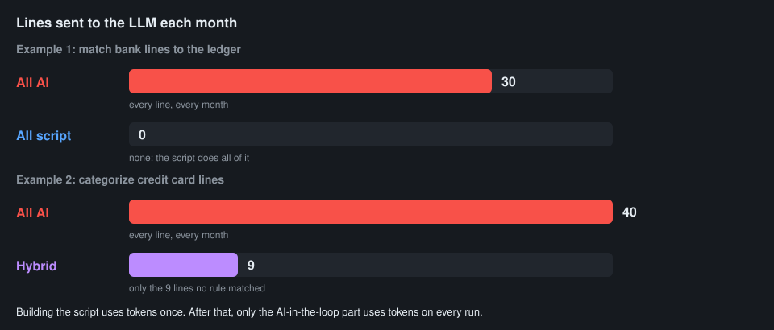

# Demo: two examples

| | Example 1: all AI → 📜 all script | Example 2: all AI → 🔀 hybrid |
|---|---|---|
| **Task** | Match a month of bank lines to the ledger | Categorize a month of credit card lines |
| **Why this bucket** | Fixed rules: same reference, same amount, dates within 3 days. No judgment. | Rules catch most lines; a few memos need judgment |
| **Lines sent to the LLM each month** | 30 → 0 | 40 → 9 |
| **Tokens per run** | Large → none | Large → small |
| **Same answer every month?** | Not guaranteed → yes | Not guaranteed → yes for the 31 matched lines |

**Files in `demo-files/`:**

| File | What it is |
|---|---|
| `bank.csv`, `ledger.csv` | Example 1: 30 made-up bank lines and 29 ledger entries |
| `match.py` | Example 1: backup copy of the script |
| `transactions.csv` | Example 2: 40 made-up credit card lines |
| `vendor_rules.csv` | Example 2: "if the memo contains X, the category is Y", 21 rules |
| `categorize.py` | Example 2: backup copy of the script |

The backup scripts are there in case the live one goes sideways.

## Example 1: all AI → all script

1. Show the data.
    - a. Open `bank.csv` and `ledger.csv`.
    - b. "Imagine doing this every month, for every client."
2. All AI.
    - a. Upload both files.
    - b. Prompt: *"Match each bank line to a ledger entry. Show the matched pairs, the bank lines with no ledger entry, and the ledger entries that haven't cleared."*
    - c. Point out: every line went to the LLM, and it will again next month.
3. Ask for the design first.
    - a. Prompt: *"I do this every month. Before building anything: restate the task as inputs → outputs, list the hard inputs, and propose the design with the least AI in the loop. Label each step Scripting or AI in the loop and rate tokens per run: none, small or large."*
    - b. Expect: all script. A match is the same reference, the same amount, and dates a few days apart.
4. All script.
    - a. Prompt: *"Write a Python script that does this match and writes the three lists to CSV files. Print only the counts. Run it."*
    - b. Expect: 28 matched, 2 bank lines not in the ledger, 1 ledger entry not yet cleared. (Backup: `match.py`.)
    - c. Point out: next month, running the script uses no tokens.

## Example 2: all AI → hybrid

1. Show the data.
    - a. Open `transactions.csv`.
    - b. Point out the many spellings of Amazon and Uber, and the `SQ *`, `TST*` and `PAYPAL *` lines.
2. All AI.
    - a. Upload `transactions.csv`.
    - b. Prompt: *"Categorize every line into Office supplies, Software, Travel, Meals, Auto, Utilities, Postage or Other. Return a table."*
    - c. Point out: every line went to the LLM.
3. Hybrid.
    - a. Upload `vendor_rules.csv`.
    - b. Prompt: *"Write a Python script that applies these rules to the transactions, writes categorized.csv, and writes the unmatched lines to leftovers.csv. Print only the counts. Run it."*
    - c. Expect "40 lines: 31 matched a rule, 9 left over." (Backup: `categorize.py`.)
    - d. Prompt: *"Now categorize only the lines in leftovers.csv, and say how sure you are about each one."*
    - e. Point out: 9 lines went to the LLM instead of 40.
4. Close the loop.
    - a. Prompt: *"Which of your answers for the leftovers would make good new rules? Add them to vendor_rules.csv."*
    - b. Point out: next month, fewer leftovers and fewer tokens.

## Running the script itself uses no tokens

- In the Claude app, Claude Code on the web, or Claude Code on your computer signed in with your Claude plan, Claude can run a script it wrote, and the work inside the script uses no tokens.
- What does use tokens: what passes through Claude, such as the command, and anything Claude reads back from the script.
- So ask the script to **print only a short summary** (counts, the leftovers). If nothing after the script needs an LLM, it can write its results to a file that Claude never reads.
- **If you use Claude through the API** (pay per use): you know who you are, and costs work differently. That's a separate conversation.
