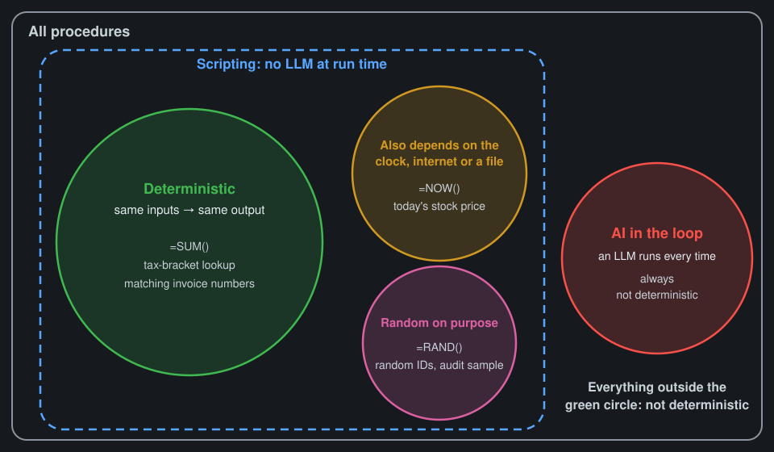

# Concepts: script or AI?

## Three buckets

| Bucket | What happens at run time | Tokens per run |
|---|---|---|
| **Scripting** | Code runs. AI may have written the code, its tests and its sample data, but no LLM runs now. | None |
| **AI in the loop** | An LLM is called every time the task runs. | Small to large, every run |
| **Hybrid** | Some steps are scripting, some are AI in the loop. | Only for the AI steps |

- AI helping you **build** a script doesn't make it AI in the loop.
- Writing tests and sample data with AI is part of building, so it's scripting too.

## What "deterministic" means

**Strict definition: deterministic means the same inputs always give the same output.**

- **Same inputs → same output:** `=SUM()`, a tax-bracket lookup, matching invoice numbers.
- **Also depends on the clock, the internet or a file:** `=NOW()`, today's stock price, today's exchange rate.
- **Random on purpose:** `=RAND()`, random IDs, an audit sample.
- **AI in the loop:** always non-deterministic.
- **Scripting covers three of the four regions.** Being deterministic is not the same as being a script.

### Determinism doesn't decide the bucket

- Many scripts aren't deterministic (clock, internet, randomness), and they're still scripts.
- Ask "does any step need an LLM's judgment at run time?" instead.

### Randomness in LLMs

- Built into how an LLM picks each word
- Can't be turned off by a Claude user
- Hard to remove completely, even for developers who control every setting
- A tiny change in the input → possibly a different whole answer
- What you type isn't the whole input: the app adds its own instructions, the date, memory, earlier messages

## Data type doesn't decide the bucket

| Data type | Scripting example | AI-in-the-loop example |
|---|---|---|
| **Numbers** | Totals, reconciliations, depreciation schedules | Reading figures off a messy scanned statement |
| **Language** | Find-and-replace, templated engagement letters, a date in a fixed-format file name | Drafting a client explanation of a variance |
| **Images** | Removing a plain background by color | Reading a crumpled receipt photo |
| **Audio** | Detecting a sound (a clap, a beep) | A punctuated transcript of a client call |

## The input/output lens defines the task, but doesn't decide the bucket

- **Use it to describe the task:** what goes in, what has to come out, in what format.
- **Don't use it to pick the bucket:** two tasks with the same input and output can land in different buckets.
  - Same input: PDF statements. Same output: a filled Excel form.
  - Text-based PDFs from one bank → scripting.
  - Scans and photos from many banks → hybrid.

## Rules for deciding, and their limits

**Rules of thumb:**
- Fixed format, known cases, clear rules → scripting
- Open-ended language, varied documents, judgment calls → AI in the loop
- Mostly fixed, with some messy cases → hybrid

**Why they're hard to apply:** we picture the typical input, not the hard ones.
- A scanned or tilted statement instead of a text PDF
- A vendor that changed its invoice layout
- The same vendor three ways: "Amazon", "AMZN Mktp US", "Amazon.com*2X4"
- 03/04: March 4 or April 3?
- Negative numbers in parentheses, currency symbols, a totals row inside the data
- Merged cells and two header rows in an Excel export
- Duplicate files, password-protected PDFs, a table split across pages

**So:** agree on the design with Claude **before** building anything.
- Ask for the hard inputs, not only the typical ones.
- Ask for the design with the least AI in the loop.
- Ask Claude to compare designs by tokens per run: none / small / large.
- See the prompt card and the starter CLAUDE.md.

## Tokens

- **AI in the loop:** tokens spent on every run
- **Scripting:** tokens spent once, to build; zero per run after that
- **Scale:** 500 invoices through AI in the loop = 500 rounds of tokens; through a script = build once, then free
- **Big files make it worse.** Pasting a large spreadsheet into chat burns tokens just to read it. A script reads it on your computer for free.
- **Hybrid:** send only the slice that needs judgment to the LLM; let the script do the rest

## Zero-token helpers: local machine learning models a script can call

- Not LLMs. They run on your computer. Zero tokens.
- Narrow: each one does one job.
- Setting them up takes real technical knowledge. Claude can carry most of it, but expect some back-and-forth.
- Examples are on the examples handout.

## Testing (if there's time)

- Testability comes from written-down code you can run on controlled inputs, not from being deterministic.
- **Random IDs:** test the properties: right length and format, no duplicates in 10,000 runs.
- **Today's stock price:** test the calculation with a fake price source that always returns $100.
- **Due-date reminders:** test with the clock frozen ("pretend today is April 10").
- **Audit sample:** record the random seed in the workpapers so the sample can be reproduced.
