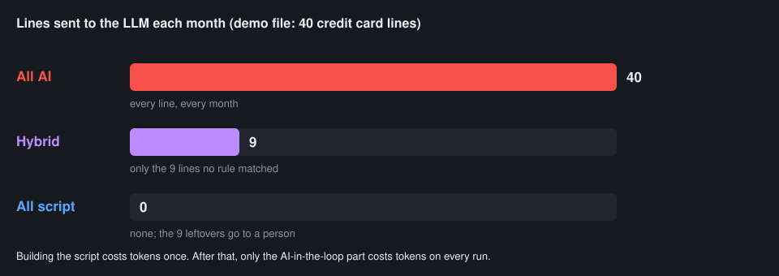

# Demo: one task, three ways

**Task:** categorize a month of credit card lines.

**Files in `demo/`:**

| File | What it is |
|---|---|
| `transactions.csv` | 40 made-up credit card lines for one month (date, memo, amount) |
| `vendor_rules.csv` | "If the memo contains X, the category is Y": 21 rules |
| `categorize.py` | Backup copy of the script, in case the live one goes sideways |

## The three ways

| | 🤖 All AI | 🔀 Hybrid | 📜 All script |
|---|---|---|---|
| **What runs each month** | Claude reads every line and picks a category | The script applies the rules; Claude sees only the lines no rule matched | The script applies the rules; a person handles the leftovers |
| **Lines sent to the LLM** | 40 of 40 | 9 of 40 | 0 of 40 |
| **Tokens per run** | Large | Small | None |
| **Same answer every month?** | Not guaranteed | Yes for the 31 matched lines | Yes |
| **New vendors** | Handled, maybe differently each time | Claude suggests; good answers become new rules | A person adds a rule |

The 9 leftovers are the hard inputs: `SQ *`, `TST*`, `PAYPAL *`, `VENMO *` and a few one-off merchants. The memo alone doesn't say what they are.

## Running it live

Works in the Claude app (upload the files; Claude can run Python there) or in Claude Code.

1. Show the data.
    - a. Open `transactions.csv`.
    - b. Point out the many spellings of Amazon and Uber, and the `SQ *` and `PAYPAL *` lines.
    - c. "Imagine 500 of these a month, every month."
2. All AI.
    - a. Upload `transactions.csv`.
    - b. Prompt: *"Categorize every line into Office supplies, Software, Travel, Meals, Auto, Utilities, Postage or Other. Return a table."*
    - c. Point out: every line went to the LLM, and it will again next month.
3. Ask for the design first.
    - a. Prompt: *"I do this every month. Before building anything: restate the task as inputs → outputs, list the hard inputs, and propose the design with the least AI in the loop. Label each step Scripting or AI in the loop and rate tokens per run: none, small or large."*
    - b. Expect a hybrid proposal: rules first, AI for the leftovers.
4. Hybrid.
    - a. Upload `vendor_rules.csv`.
    - b. Prompt: *"Write a Python script that applies these rules to the transactions, writes categorized.csv, and writes the unmatched lines to leftovers.csv. Run it."*
    - c. Expect "40 lines: 31 matched a rule, 9 left over." (Backup: `categorize.py` does the same.)
    - d. Prompt: *"Now categorize only the lines in leftovers.csv, and say how sure you are about each one."*
    - e. Point out: 9 lines went to the LLM instead of 40.
5. All script.
    - a. Same script; the 9 leftovers go to a person instead of the LLM.
    - b. Point out: zero tokens per run, and a growing rules list is the cost.
6. Close the loop.
    - a. Prompt: *"Which of your answers for the leftovers would make good new rules? Add them to vendor_rules.csv."*
    - b. Point out: next month, fewer leftovers and fewer tokens.
