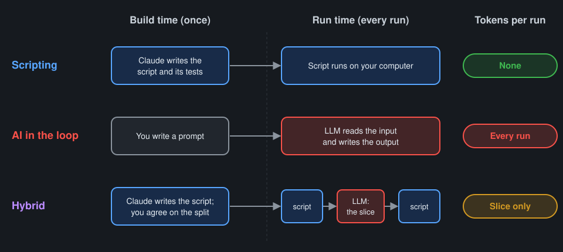
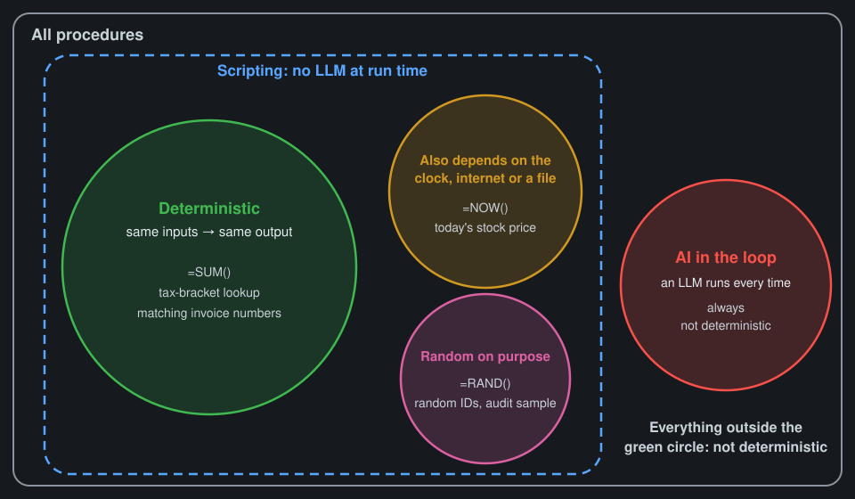
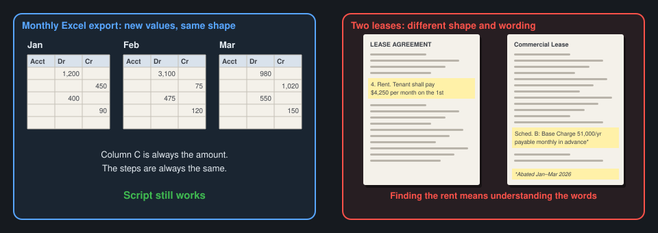
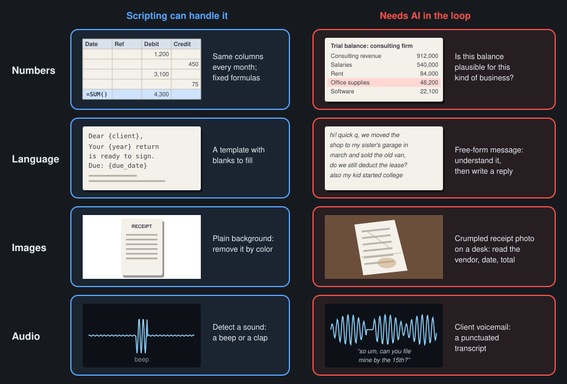
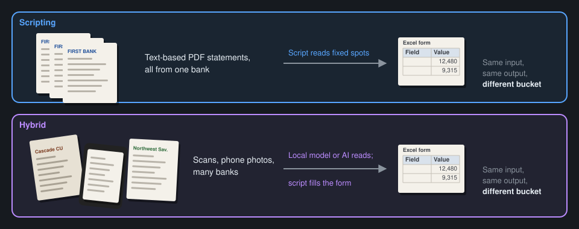
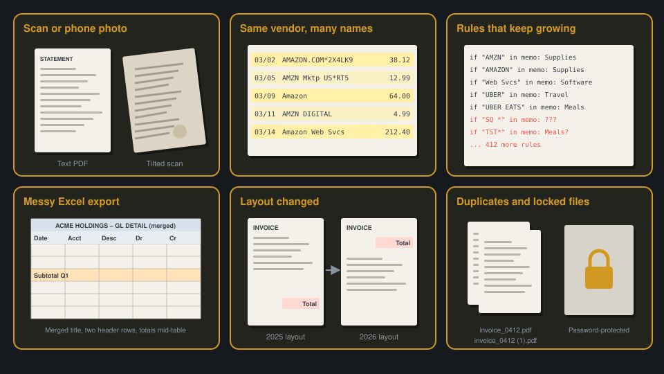
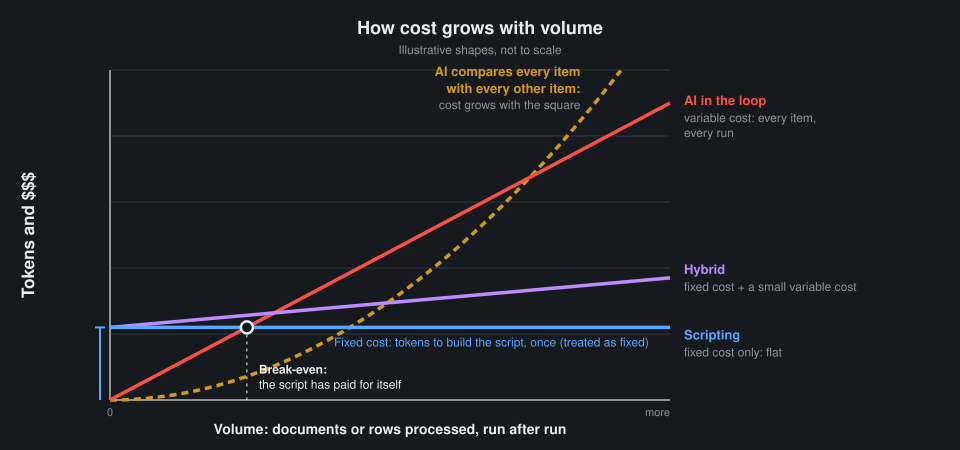

# Script or AI? Concepts and examples

## Three buckets

| Bucket | What happens at run time | Tokens per run |
|---|---|---|
| 📜 Scripting | Code runs on your computer. AI may have written the code, its tests and its sample data, but no LLM runs now. | None |
| 🤖 AI in the loop | An [LLM](https://en.wikipedia.org/wiki/Large_language_model) is called every time the task runs. | Small to large, every run |
| 🔀 Hybrid | Some steps are scripting, some are AI in the loop. | Only for the AI steps |

- AI helping you **build** a script doesn't make it AI in the loop.
- Writing tests and sample data with AI is part of building, so it's scripting too.

## What "deterministic" means

**Strict definition: [deterministic](https://en.wikipedia.org/wiki/Deterministic_algorithm) means the same inputs always give the same output.**

| Region | Examples |
|---|---|
| 🟢 Same inputs → same output | [`=SUM()`](https://support.microsoft.com/en-us/office/sum-function-043e1c7d-7726-4e80-8f32-07b23e057f89), a tax-bracket lookup, matching invoice numbers |
| 🟠 Also depends on the clock, the internet or a file | [`=NOW()`](https://support.microsoft.com/en-us/office/now-function-3337fd29-145a-4347-b2e6-20c904739c46), today's stock price, today's exchange rate |
| 🎲 Random on purpose (pseudo-random\*) | [`=RAND()`](https://support.microsoft.com/en-us/office/rand-function-4cbfa695-8869-4788-8d90-021ea9f5be73), random IDs, an audit sample |
| 🔴 AI in the loop | Every LLM call: never deterministic |

\* Random in a computer isn't truly random: the picks come from a fixed recipe and a starting number. Same starting number → same picks.

### Randomness in LLMs

- Built into how an LLM picks each word
- Can't be turned off by a Claude user
- Hard to remove completely, even for developers who control every setting
- A tiny change in the input → possibly a different whole answer
- What you type isn't the whole input: the app adds its own instructions, the date, memory, earlier messages

## What a script can't do

A script needs you to say **in advance** where to look and what to do with what it finds.

| | Changes from run to run | Script still works? |
|---|---|---|
| 📊 Monthly Excel export | The **values**. Column C is always the amount; the steps are always the same. | ✅ Yes |
| 📄 A client's lease | The **shape and wording**. The rent clause can be anywhere, phrased any way, with an exception in a footnote. | ❌ No: finding it means understanding what the words mean |

- **Different values, same shape** → scripting
- **Different shape or wording, same meaning to find** → AI in the loop

## Data type doesn't decide the bucket

| Data type | 📜 Scripting example | 🤖 AI-in-the-loop example |
|---|---|---|
| 🔢 Numbers | Totals, reconciliations, depreciation schedules | Reviewing a trial balance for balances that look misclassified for this kind of business (a large "office supplies" balance at a consulting firm) |
| 💬 Language | Find-and-replace, templated engagement letters, a date in a fixed-format file name | Drafting a client explanation of a variance |
| 🖼️ Images | Removing a plain background by color | Reading a crumpled receipt photo |
| 🎙️ Audio | Detecting a sound (a clap, a beep) | A punctuated transcript of a client call |

## The input/output lens defines the task, but doesn't decide the bucket

- **Use it to describe the task:** what goes in, what has to come out, in what format.
- **Don't use it to pick the bucket:** the same input and output can land in different buckets.

## Clear-cut examples

| Task | Bucket | Why |
|---|---|---|
| Match bank transactions to the ledger by amount, date and reference | 📜 Scripting | Fixed rules; same data in, same matches out |
| Roll forward a depreciation schedule | 📜 Scripting | Pure calculation; Excel already does this |
| Rename and file 200 PDFs by client ID from a system export | 📜 Scripting | The ID is in a fixed place in each file name |
| Combine monthly CSV exports from the same system into one workbook | 📜 Scripting | Same columns every month |
| Convert balances at today's published exchange rate | 📜 Scripting | Depends on the internet, but needs no judgment |
| Pick a random audit sample | 📜 Scripting | Random on purpose; the script saves the starting number for its (pseudo) random picks, so anyone can draw the exact same sample again |
| Draft a client email explaining a variance | 🤖 AI in the loop | New wording for each client and situation |
| Summarize the key terms of a 40-page lease | 🤖 AI in the loop | The terms can be anywhere, worded any way |
| Answer a client's free-form question | 🤖 AI in the loop | No way to list the questions in advance |
| Turn meeting notes into action items | 🤖 AI in the loop | Deciding what counts as an action means understanding the conversation |

## Rules for deciding, and their limits

**Rules of thumb:**

- Same shape every time, known cases → 📜 Scripting
- Open-ended wording, varied documents, judgment calls → 🤖 AI in the loop
- Mostly the same shape, with some messy cases → 🔀 Hybrid

**Why they're hard to apply:** we picture the typical input, not the hard ones.

| Task that looks like scripting | ⚠️ Hard input that's easy to overlook | What it does to the design |
|---|---|---|
| Pull totals from bank statement PDFs | 📷 Some statements are scans or phone photos | Text extraction fails on those; add a local model or AI in the loop for those files only |
| Categorize credit card transactions by vendor | 🔤 "Amazon", "AMZN Mktp US", "Amazon.com*2X4" | Rules need a **lookup table that grows**; unmatched lines need a review path |
| Categorize transactions from free-text memo lines | 🌀 Hundreds of wordings, abbreviations and typos | The script **grows to an enormous size and still misses cases**; that's the signal to move to hybrid |
| Import a client's Excel export | 🧩 Merged cells, two header rows, a totals row in the middle | The script needs cleanup steps, tested on real exports |
| Fill a form from vendor invoices | 🔁 A vendor changed its invoice layout | Fixed-position rules break silently; add a check that catches missing fields |
| Process a folder of client documents | 🔒 Duplicates, password-protected PDFs | The script needs to detect and list them, not skip them silently |

**So:** agree on the design with Claude **before** building anything.

- Ask for the hard inputs, not only the typical ones.
- Ask for the design with the least AI in the loop.
- Ask Claude to compare designs by tokens per run: none / small / large.
- See the prompt card and the starter [CLAUDE.md](https://code.claude.com/docs/en/memory).

## Tokens

| | 📜 Scripting | 🔀 Hybrid | 🤖 AI in the loop |
|---|---|---|---|
| Tokens to build | Once | Once | A prompt |
| Tokens per run | None | Small: only the slice that needs judgment | Large: every run |
| 500 invoices | Build once, then free | 500 small calls | 500 full calls |
| A large spreadsheet | The script reads it on your computer for free | The script sends only the rows that need judgment | Pasting it into chat burns tokens just to read it |

- **Big files make it worse.** Pasting a large spreadsheet into chat burns tokens just to read it.
- **Hybrid:** send only the slice that needs judgment to the LLM; let the script do the rest.

## How cost grows with volume

Read it like a cost-volume (break-even) chart:

- **Scripting = fixed cost.** Tokens to build it once, then a flat line.
- **AI in the loop = variable cost.** Every item, every run.
- **Hybrid = fixed cost + a small variable cost.**
- **Break-even:** the volume where the script has paid for itself. For a task you repeat, that comes early.
- **Watch for the curve.** Comparing every item with every other item (finding duplicates, fuzzy matching) grows with the square of the volume.

| Volume | 📜 Scripting | 🔀 Hybrid (1 item in 10 needs judgment) | 🤖 AI in the loop | ⚠️ AI compares every item with every other |
|---|---|---|---|---|
| 10 items | Build cost | Build cost + 1 | 10 | 100 |
| 100 items | Build cost | Build cost + 10 | 100 | 10,000 |
| 1,000 items | Build cost | Build cost + 100 | 1,000 | 1,000,000 |

One unit = the tokens for one item or one comparison.

**Only steps that use tokens belong on this chart.** A finished script uses no tokens per run, so there's nothing to plot for it: its line is flat.

## Is it worth converting?

Converting a task from all AI to hybrid or script takes effort. The return depends on two things together:

- **The shape of today's line:** how the tokens grow as you process more lines, documents or clients.
- **Your volume over a year:** how many per run × how often you run it. 100 records every day is about 36,000 a year.

A steep line doesn't matter at a tiny volume. A gentle line matters a lot at a large one.

| Workflow | Volume | Today's line (all AI) | After converting | Return |
|---|---|---|---|---|
| Categorize credit card lines | About 3,000 lines a month | Rises with every line | Rules catch most lines; AI sees the leftovers | 🟢 Large |
| Find duplicate vendor payments | About 5,000 payments a year | Curves upward: every payment against every other | A script finds the exact matches; AI checks the near-matches | 🟢 Largest |
| Pull amounts from W-2s | About 15 forms a year | Rises with every form | Flat, but building it costs more than a year of doing it with AI | 🟠 Not yet |
| Answer client questions | About 30 emails a month | Rises with every email | Almost the same line: every email still needs reading and writing | ⚪ None |

**What to look for:**

- **Does converting change the shape of the line, or only nudge it?** A changed shape is worth more than a small drop.
- **Is your volume past break-even?** If not, leave the task with AI and check again when the volume grows.
- **Several candidates?** Get this picture for each one, then convert the one with the biggest gap at your volume first.
- **Volume first, chart second.** A chart drawn before your volume is known shows nothing useful. If the lines are close at your volume, the answer is "leave it," and no chart is needed.
- **One exception to the yearly total:** a step that compares every item with every other depends on how many are in one run, not on the total for the year.

There's no rule for "big enough" that fits every firm. Ask Claude to work it out for your task and your volume. The prompt card has three prompts for this: "Is it worth converting?", "Plot it" and "Which one first?"

## Hybrid patterns

Agree on the split for each one before building.

| Pattern | 📜 Scripting part | 🤖 AI-in-the-loop part | The seam |
|---|---|---|---|
| **AI extracts → script processes** | Validate, total, fill the Excel form | Pull fields from messy PDFs into a [CSV](https://en.wikipedia.org/wiki/Comma-separated_values) | Fixed CSV columns; the script rejects rows that fail checks |
| **Script filters → AI judges** | Run the reconciliation, find the exceptions | Draft the explanation for only the exceptions | The script sends only the exception rows, not the whole file |
| **Rules first, AI for leftovers** | Categorize by vendor rules (most transactions) | Categorize only the unmatched ones | Unmatched list → AI → review list; good answers become new rules |
| **AI first, then promote to script** | Later: the script that replaced the AI step | Early: do the task with AI a few times | Once the pattern is stable, ask Claude to turn it into a script |

- **Not hybrid:** AI writing a script's tests or sample data. That's part of building, so it's scripting.

## Zero-token helpers: local machine learning models a script can call

| Need | 💻 Local model | Notes |
|---|---|---|
| Text from scanned documents (optical character recognition) | [Tesseract](https://github.com/tesseract-ocr/tesseract) | Struggles with poor scans and handwriting |
| Speech to text | [whisper.cpp](https://github.com/ggml-org/whisper.cpp), [Vosk](https://alphacephei.com/vosk/) | Runs offline; larger models need a stronger computer |
| Categorize transactions from the firm's own past entries | [scikit-learn](https://scikit-learn.org/stable/) | Needs enough past examples to learn from |
| Find names, dates and amounts in text | [spaCy](https://spacy.io/) | Accuracy depends on the type of text |
| Remove an image background | [rembg](https://github.com/danielgatis/rembg) | Downloads a model file on first run |

- Not LLMs. They run on your computer. Zero tokens.
- Narrow: each one does one job.
- Setting them up takes real technical knowledge. Claude can carry most of it, but expect some back-and-forth.

## Controls for scripts

You can't read the code, but you can ask for the same controls you'd expect anywhere else. These are the failures you won't see unless you ask.

| Control | What goes wrong unseen | Accounting equivalent | Ask Claude |
|---|---|---|---|
| 📣 **Fail loudly** | The script skips rows it can't read and still reports success | Exceptions report | "What does the script do with a row it can't process? Show me the list." |
| 🧮 **Control totals** | 500 rows in, 487 out, and nobody notices | Batch totals, tie-out | "Do rows in equal rows out plus rejected? Do the totals tie?" |
| 💵 **Money math** | Cents drift, or the script rounds differently from Excel | Rounding policy | "How is money stored and rounded? Does it match Excel?" |
| 🔁 **Safe to run twice** | A rerun doubles the entries | Double posting | "What happens if I run this twice?" |
| 🔒 **Never overwrite an input without asking first** | The script replaces the only copy of a source file | Source documents stay untouched | "Does it change or delete any file it reads? Write results to a new file." |
| 🔤 **Text that looks like numbers** | Account 00123 becomes 123; dates shift | Leading zeros in account numbers | "Which columns are read as text, numbers and dates?" |
| ⚙️ **Settings out of the code** | A tax rate or cutoff date is buried in the script | Assumptions on their own tab, not inside formulas | "Which values are fixed in the code? Move them to a settings file." |
| 📝 **Run log** | Nobody can say which version and which input produced a number | Audit trail | "Does each run record the date, input file, row counts and version?" |
| 📦 **What it installs and sends** | A downloaded add-on, or data leaving your computer | Vendor due diligence | "What does it install? Does it send data anywhere?" |
| ♻️ **Changes can break what worked** | Claude fixes one case and breaks another | Re-performing a test after a change | "Rerun the earlier sample inputs after every change." |

### Money math: why to ask

- Ordinary computer decimals can't hold 0.10 exactly: 0.10 + 0.20 comes out as 0.30000000000000004.
- Python's built-in rounding sends 2.5 to 2. Excel's [`ROUND`](https://support.microsoft.com/en-us/office/round-function-c018c5d8-40fb-4053-90b1-b3e7f61a213c) sends it to 3.
- Python rounds 2.675 to 2.67. Excel gives 2.68.
- The fix exists (exact decimal arithmetic and a stated rounding rule). Claude applies it reliably when you ask.

### What you don't need to learn

- Big O notation, algorithms and data structures
- Design patterns and programming languages
- Performance tuning

Claude handles these. When they go wrong, the script is slow, and you can see that for yourself.

## Sort these: discuss and vote

For each task, vote: 📜 Scripting, 🤖 AI in the loop or 🔀 Hybrid. Then ask: what hard inputs could change the answer? Reveal the hints one at a time, then the answer.

**1. Email every client a reminder 30 days before their filing deadline**

Hints and answer

- Hint: Where does each deadline come from: a list, or someone's judgment?
- Hint: Is the email wording the same for every client?
- Answer: 📜 Scripting. Depends on the clock, but the rule is fixed: deadline minus 30 days, same template.

**2. Write a personal year-end note to each client about their year**

Hints and answer

- Hint: Which part is pulling each client's figures, and which part is writing?
- Hint: Does each note need new wording?
- Answer: 🔀 Hybrid. The script pulls each client's figures; AI writes the note from only those figures.

**3. Flag possible duplicate vendor payments**

Hints and answer

- Hint: What if the same invoice was entered twice with the same number and amount?
- Hint: What about "ACME Inc" vs. "Acme, Inc." with amounts a cent apart?
- Answer: 📜 Scripting, maybe 🔀 Hybrid. Exact matches are rules; near-matches may need AI for the leftovers.

**4. Turn client voicemails into tasks with the client's name and a due date**

Hints and answer

- Hint: Turning speech into text: does that need an LLM, or can a local model do it?
- Hint: Picking a name and a due date out of a rambling message: rules, or understanding?
- Answer: 🔀 Hybrid. A local speech-to-text model (zero tokens), then AI picks out the name and due date from the transcript.

**5. Build a monthly KPI summary from the general ledger export**

Hints and answer

- Hint: Does the export have the same columns every month?
- Hint: Are the KPI formulas the same every month?
- Answer: 📜 Scripting. Same export, same calculations every month.

**6. Pull box amounts from W-2s that clients upload**

Hints and answer

- Hint: What if every W-2 is a text PDF from the same payroll provider?
- Hint: What if some are phone photos?
- Answer: 🔀 Hybrid. Text PDFs → script; scans and photos → local optical character recognition or AI; the script checks totals either way.

**7. Categorize 3,000 credit card lines from their memo text**

Hints and answer

- Hint: How many lines could a vendor lookup table catch?
- Hint: What happens to the rules list as you chase the rest?
- Answer: 🔀 Hybrid. Rules first, AI for leftovers; the rules list grows from the AI's reviewed answers.

**8. Decide whether a receipt is a deductible business expense for this client**

Hints and answer

- Hint: Can you list in advance every kind of receipt and every kind of business?
- Hint: Who is accountable for the decision?
- Answer: 🤖 AI in the loop, plus a person. Judgment about this client's business; a person signs off.

## Testing (if there's time)

- Testability comes from written-down code you can run on controlled inputs.
- **Random IDs:** test the properties: right length and format, no duplicates in 10,000 runs.
- **Today's stock price:** test the calculation with a fake price source that always returns $100.
- **Due-date reminders:** test with the clock frozen ("pretend today is April 10").
- **Audit sample:** the script saves the starting number for its (pseudo) random picks in the workpapers, so a reviewer can draw the exact same sample again and check it.
